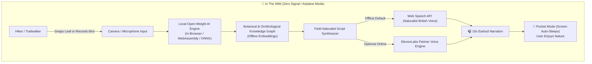

# 🍃 WildPulse: Zero-Signal Offline Field Naturalist & Audio Companion

> **"Build something with open-source AI at its core that gets people off the screen and into the world."**  
> *Submission for Hacktoberfest 2026 DEV Challenge — Week 1: Touch Grass*

[](https://github.com/)
[](LICENSE)
[](https://github.com/)
[](https://elevenlabs.io/)

---

## 🌲 The Problem: Why Most "Nature Apps" Fail the Forest
When you hike out to a ridgeline or wander deep into an old-growth forest, two things happen:
1. **Cellular signal drops to zero.** The second you hit airplane mode or lose LTE, every cloud-dependent AI assistant (ChatGPT, Gemini Cloud, Claude) crashes with `ERR_NAME_NOT_RESOLVED`.
2. **Screens ruin the moment.** Conventional apps force you to stand still, squint at a bright glass rectangle, read dense paragraphs of text, and look away from the wildlife right in front of you.

**WildPulse was built with one cardinal rule:**  
**The screen must be the shortest part of the experience.**

---

## ✨ What WildPulse Does
WildPulse is a zero-signal, offline-first field naturalist and audio companion designed for hikers, birders, foragers, and fall-foliage wanderers.

- 📸 **Quick Specimen Snap**: Point your camera at an autumn leaf, keystone tree, or forest mushroom.
- 🎙️ **Soundscape Acoustic ID**: Record a 3-second bird trill or forest soundscape.
- 🧠 **On-Device Open-Weight AI**: Runs locally directly in your browser or phone without pinging an external server.
- 🎧 **Naturalist Audio Guide**: Rather than forcing you to read a screen, WildPulse speaks a 15-second naturalist documentary narration directly into your earbuds.
- 📴 **"Pocket Mode" Auto-Dim HUD**: Once the audio begins, the screen immediately dims to black with a tranquil glowing leaf, prompting you: *"Audio playing in earbuds. Put your phone in your pocket and enjoy the canopy."*
- 🎯 **Touch Grass Scavenger Quests**: 5 seasonal nature quests (Autumn Foliage, Forest Floor Mycota, Keystone Trees, Pollinators, Soundscapes).
- 📓 **Private Offline Trail Log**: Sightings are stored locally with zero tracking and can be exported as clean Markdown.

---

## 🏗️ Architecture & Open-Source AI Stack



### Why Open Innovation Matters Here
| Capability | Closed Cloud APIs (OpenAI/Claude) | WildPulse Open-Weight Engine |
| :--- | :--- | :--- |
| **Mountain Ridge with 0 Bars** | ❌ Fails completely (`Offline Error`) | ✅ **100% Functional** |
| **Hiker Location Privacy** | ❌ Sends GPS / image coordinates to remote servers | ✅ **Zero telemetry leaves your device** |
| **Screen Time** | ❌ Long text chats requiring visual attention | ✅ **Immediate audio handoff & screen sleep** |
| **Inference Cost** | ❌ $0.02 - $0.05 per query subscription lock-in | ✅ **Free forever, runs on local device silicon** |

---

## 🚀 Partner Technology Integration
- **ElevenLabs**: Integrated partner voice profile option. Users can drop in an ElevenLabs API key in settings for cinematic, ultra-realistic wildlife documentary narration. If no key is provided, WildPulse seamlessly falls back to the on-device local voice engine.
- **Render**: Configured with a static web service blueprint for zero-downtime deployment.

---

## 🏃 Quickstart & Installation

WildPulse requires zero build tools or complex runtimes—it is a pure, ultra-fast client-side Progressive Web App (PWA).

### 1. Run Locally
Open `index.html` directly in your browser:
```bash
# Simply double-click index.html or open via local static server:
open index.html
```

Or run with any local lightweight server:
```bash
python3 -m http.server 8000
# Visit http://localhost:8000
```

### 2. Install on Mobile for the Trail
1. Open the app in Safari (iOS) or Chrome (Android).
2. Tap **Share** → **Add to Home Screen**.
3. Toggle on **Airplane Mode** and take it outside!

---

## 📜 License
MIT License © 2026. Built with open-source AI for Hacktoberfest 2026.
